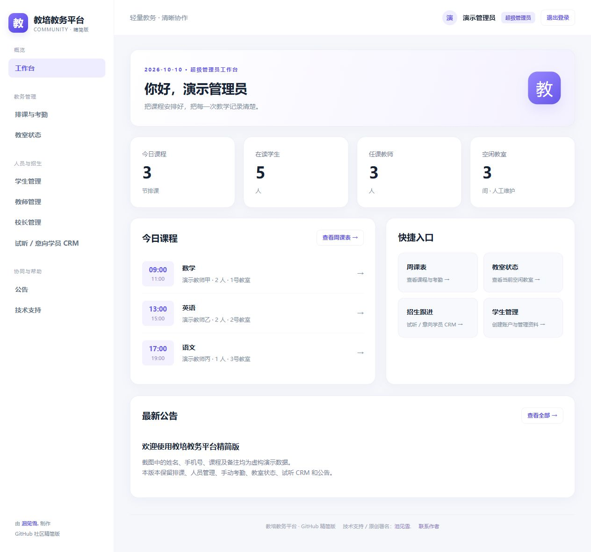
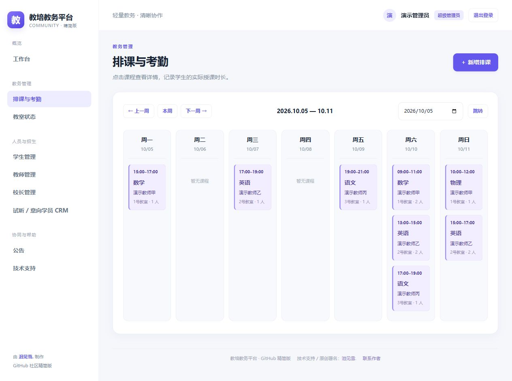
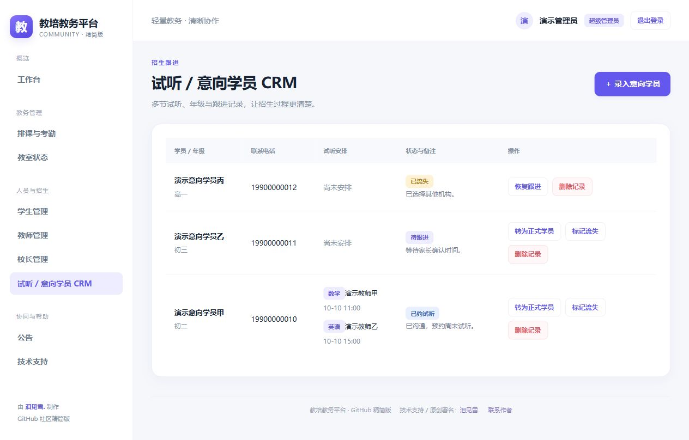
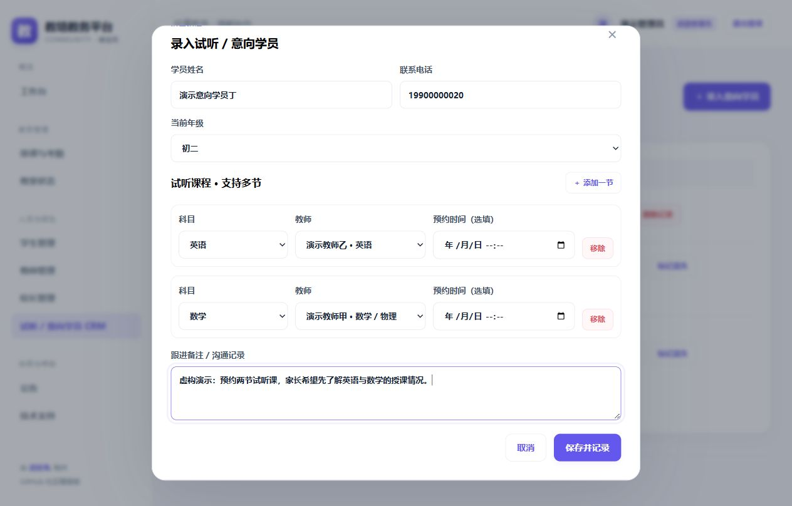
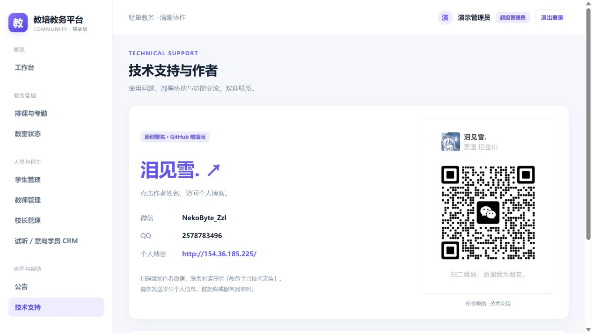
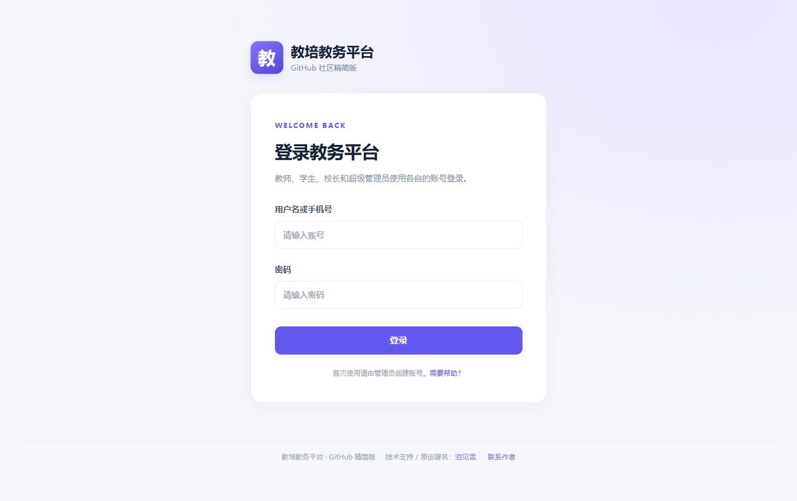

# 教培教务平台 · 精简版

一个适合单校区、小规模使用的教务管理 Web 应用。使用 Python、Flask 和 SQLite，可独立运行，不依赖完整版服务。

**作者：[泪见雪.](http://154.36.185.225/)** · 微信：`NekoByte_Zzl` · QQ：`2578783496`

## 功能

| 模块 | 精简版能力 |
| --- | --- |
| 账号与人员 | 超管、校长、教师、学生四种角色；创建账户时填写姓名、年级、教师科目、手机号及归属；修改账号资料、密码；管理备注仅管理人员可见 |
| 排课 | 按具体日期创建排课；周课表；点击课程进入详情；科目与教师双向筛选；支持多人课程；检查教师、学生、教室时间冲突 |
| 手动考勤 | 管理员和任课教师登记到课情况及实际授课分钟数；半小时向上折算；重复保存更新原记录 |
| 教室状态 | 自定义教室；空闲、占用、维修中；管理人员维护详细备注；师生查看状态 |
| 试听 CRM | 年级、多节试听的科目、教师和时间；跟进备注；标记流失、恢复跟进、删除误录记录；转为正式学生并保留线索历史 |
| 公告 | 管理人员发布，全体登录人员查看 |
| 技术支持 | 作者署名、可点击博客链接、微信 / QQ 和微信二维码 |

此版本**不包含**财务算薪、预存月结、智能排课、OCR、小程序、动态扫码和私信。教室状态由管理人员手动维护，不自动随课程变更。年级手动维护，不包含年度自动升级。采用单校区结构，未提供多校区隔离、手机号别名、多次循环排课或校外占用管理。手动考勤记录时长，不执行消课扣费。

## 参考截图

以下是精简版的实际界面截图，所有人员、号码、课表和备注均为虚构演示数据。

### 工作台



### 周课表



### 试听 / 意向学员 CRM



### 多节试听录入



### 技术支持与作者署名



### 登录页



## 本地运行

需要 Python **3.11 或更新版本**。建议先使用空数据库本地试运行。仓库不提供生产数据、服务器配置或默认账号密码。

```bash
python -m venv .venv
```

Windows PowerShell：

```powershell
.\.venv\Scripts\Activate.ps1
```

Linux / macOS：

```bash
source .venv/bin/activate
```

安装依赖，并复制配置模板：

```bash
pip install -r requirements.txt
python -c "from pathlib import Path; import secrets; p=Path('.env'); p.exists() and exit('.env already exists; edit it manually.'); p.write_text('SECRET_KEY=' + secrets.token_hex(32) + '\nCOOKIE_SECURE=0\n', encoding='utf-8')"
```

上述命令适用于首次创建 `.env`，已有文件会拒绝覆盖。也可复制 `.env.example`，手动填写随机 `SECRET_KEY`。

初始化管理员（交互输入用户名和密码，密码至少 12 位）：

```bash
flask --app run:app init-db
python run.py
```

浏览器[打开本地应用](http://127.0.0.1:5003)。初始化命令不删除旧表、不覆盖已有管理员。依次创建教师、学生和教室，即可排课。本人未首次登录不影响管理人员排课。

## 部署说明

- 使用独立目录、独立密钥、独立数据库；不要连接完整版的数据库。两版数据库结构不兼容。
- `python run.py` 是本地开发入口。正式部署使用 WSGI 服务并配置 HTTPS 反向代理。
- Linux 示例：`pip install gunicorn`，然后 `gunicorn --workers 1 --threads 1 --bind 127.0.0.1:5003 run:app`。SQLite 精简版推荐单进程、单请求线程，小规模使用。
- HTTPS 下设置 `.env` 中的 `COOKIE_SECURE=1`。不要将开发端口直接暴露到公网。
- 上线前通过反向代理配置登录请求限流。应用自身也按直接连接 IP 限流，反向代理部署时该 IP 可能是代理地址，应在代理端补充按客户端 IP 限流。
- 数据保存在 `instance/lite.db`。定期备份，并保护备份权限。数据库、日志、`.env` 和上传目录均被 `.gitignore` 排除。
- 授课时间按中国标准时间显示。Windows 时区数据依赖 `tzdata`，已列入安装依赖。
- 当前没有数据迁移框架、大规模部署或高可用支持；升级数据库结构前需备份并自行规划迁移。

## 测试

```bash
python -m unittest discover -s tests -v
```

20 项测试覆盖权限边界、备注隐私、科目匹配、时间冲突、手动考勤折算、重复号码提示、试听流失 / 恢复 / 删除 / 转化、表单 CSRF、HTML 转义、密码修改后的会话失效和数据库初始化保护。GitHub Actions 配置了 Python 3.11 / 3.12 / 3.13 测试矩阵。

## 技术支持与署名

作者 **[泪见雪.](http://154.36.185.225/)**。页面侧栏、全局页脚和技术支持页均包含署名，点击姓名可跳转个人博客。

- 微信：`NekoByte_Zzl`
- QQ：`2578783496`
- 博客：[http://154.36.185.225/](http://154.36.185.225/)
- 联系时请注明「教务平台技术支持」。
- 演示版本为阉割版，对照如下
## 精简版与完整版的区别

本仓库为适合单校区、小规模使用的精简版，功能差异如下：

| 模块 | 精简版的限制 |
| --- | --- |
| 财务收费 | 不包含学生收费标准、预存扣费、余额用完转月结、每月结算、订单及财务明细 |
| 教师算薪 | 不包含工资标准、一对一／班课计薪、按人数计算工资及工资报表 |
| 扫码考勤 | 不包含动态二维码、上下课自动识别、临时调课扫码及自动消课扣费；仅保留手动登记授课时长 |
| 签到表 | 不包含拍照上传、OCR 识别及批量登记考勤 |
| 高级排课 | 不包含智能排课、预排课、循环排课、教师校外占用管理及日／月／列表视图；仅保留周课表 |
| 排课修改 | 可以新增、查看和删除未登记考勤的课程，没有已创建课程的编辑入口 |
| 多校区 | 不包含校区管理、师生跨校区关联及财务、教室的校区划分 |
| 教室自动化 | 不自动随上下课占用或释放教室，状态由管理人员手动维护 |
| 学生账号与年级 | 不包含多个手机号共同登录、首次登录完善资料及每年九月自动升年级 |
| 教学管理 | 不包含作业布置与提交、批改、成绩、请假审批、补签申请及考勤申诉 |
| 互动通知 | 不包含私信、投诉建议、课后评价及个人消息通知 |
| 统计与系统 | 不包含收支利润分析、教师业绩与考勤统计、完整系统设置及后台一键备份 |
| 微信小程序 | 不包含小程序工程及配套接口 |
| CRM 后续维护 | 保留录入、多节试听、标记流失、恢复跟进、删除及转为正式学员；不包含后续编辑资料、调整试听课和追加跟进记录的完整流程 |

### 保留的核心功能

- 超级管理员、校长、教师、学生四种角色。
- 人员管理、姓名、年级、教师科目、手机号归属及管理人员私密备注。
- 科目与教师双向筛选、多人排课及教师、学生、教室时间冲突检查。
- 周课表、课程详情及手动考勤，授课时长按半小时向上折算。
- 教室空闲、占用、维修状态的人工维护。
- 基础试听 CRM、多节试听及学员转化。
- 公告发布与查看。

> 精简版使用独立代码和数据库，与完整版数据库结构不兼容，不能直接连接主站数据库使用。手动考勤仅记录授课时长，不执行扣费或工资结算。


Copyright © 2026 泪见雪. 本仓库公开展示精简版源码；未指定开源许可证，其他使用授权请联系作者。
